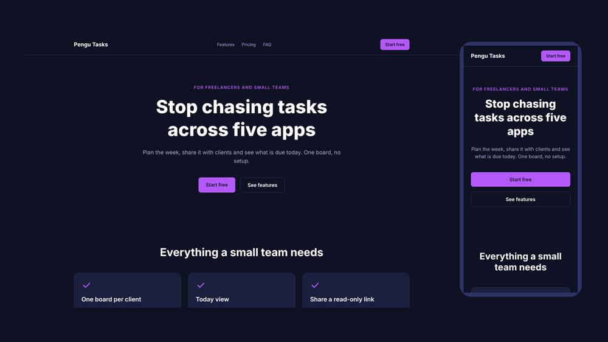

# pengu-landing-page

An open-source landing page template built with AI ("vibe coding") and shipped **together with the exact prompts used to generate it**, including the parts that went wrong.



- **Stack:** Next.js 16 (App Router) · Tailwind CSS 4 · TypeScript
- **Sections:** Hero, Features, Pricing, FAQ, Footer
- **No extra dependencies** beyond the official `create-next-app` starter
- **License:** MIT

## Quick start

Requires Node.js 20.9 or later.

```bash
git clone https://github.com/pengucoder-vibecoding/pengu-landing-page.git
cd pengu-landing-page
npm install
npm run dev
```

Open http://localhost:3000.

## Make it yours

| What | Where |
|---|---|
| All text, prices and links | `lib/content.ts` |
| Colors and fonts | the `@theme` block in `app/globals.css` |
| Sections and their order | `app/page.tsx` and `components/` |

"Pengu Tasks" and the prices are placeholders. Replace them before you publish.

## How it was built

Every step lives in [`prompts/`](./prompts) as: the prompt, what the AI returned, and what was fixed.

1. [`01-plan.md`](./prompts/01-plan.md): plan only, plus a list of the model's assumptions. No code.
2. [`02-build.md`](./prompts/02-build.md): first build. It failed on `new Date()` under Cache Components.
3. [`03-review.md`](./prompts/03-review.md): 3 checks on v1 (hard-coded colors, mobile layout, accessibility), then one fix round.

| Check | v1 | v2 |
|---|---|---|
| Hex codes in components | 0 | 0 |
| Grids on a 375 px screen | 3 and 2 columns | 1 column |
| axe-core violations | 21 elements (contrast) | 0 |
| Focus style | browser default | 2 px brand outline |

## Contributing

Issues and pull requests are welcome. Please keep changes small and explain *why*.

## License

[MIT](./LICENSE). A small Pengu logo in the footer is appreciated but optional.

## About

Part of [Pengu Coder](https://www.facebook.com/profile.php?id=61593275422127): practical vibe coding, real prompts, open source.

<!-- TODO (owner): add a support link here once a real one exists (VietQR / GitHub Sponsors / Ko-fi). Do not add placeholder links. -->
